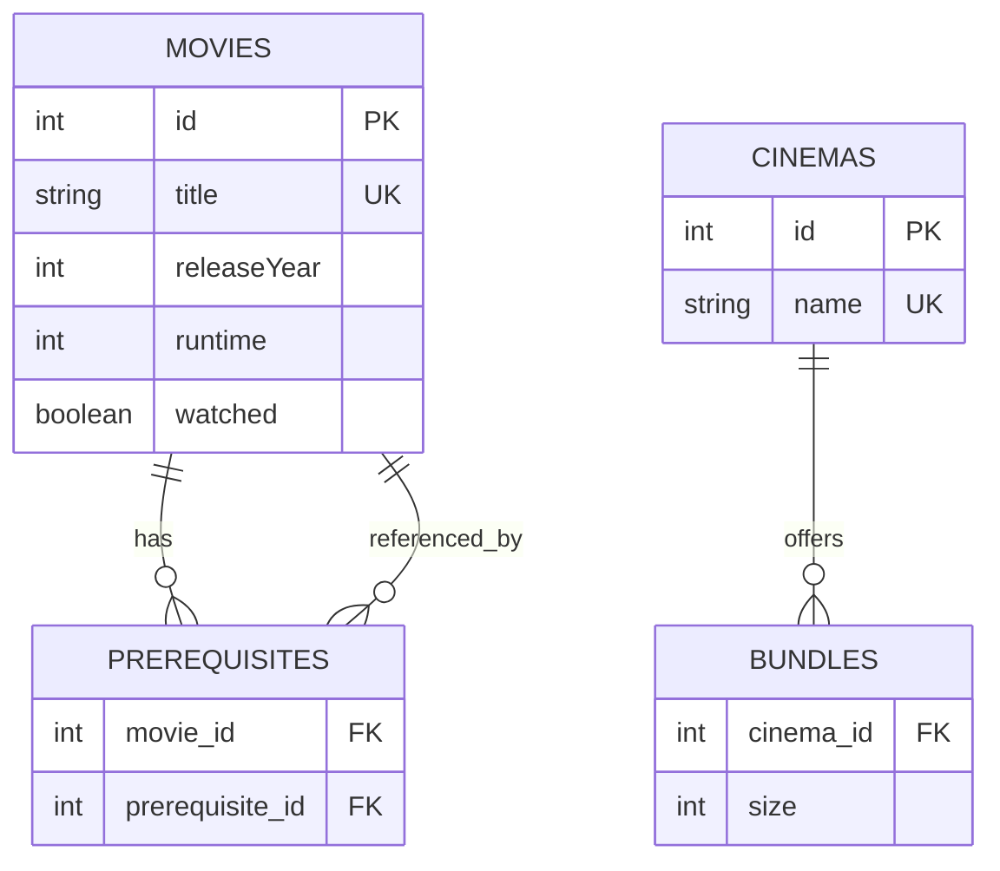

# Doomsday-Ready-Full-Stack-Application
# Doomsday Ready

MCU Rewatch Planner & Opening-Night Cinema Bundle Calculator
Blinto Talent Accelerator 2027 — Full Stack Developer Internship Assessment
Overview
Doomsday Ready is a full-stack web application that helps Marvel Cinematic Universe (MCU) fans prepare for Avengers: Doomsday. Users can manage movies and their prerequisites, generate a valid rewatch order, track watched movies and remaining runtime, and calculate the minimum number of exact-seat cinema bundles for an opening-night group.

The app provides a React interface backed by an Express REST API and SQLite persistence. Cinema booking is a quote calculator, not a payment or seat-reservation service.
Features
1. Movies
- Add movies with a unique title, release year, and runtime (1–300 minutes).
- Set and edit prerequisites (other movies to watch first).
- Mark movies as watched or unwatched.
- Reject direct or indirect dependency cycles with HTTP 409 CIRCULAR_DEPENDENCY.
2. Rewatch Plan
- Select a target movie and list all transitive prerequisites exactly once.
- Show prerequisites before dependent movies; exclude the target itself.
- Display watched count, progress, and total runtime of unwatched prerequisites.
- Use a custom depth-first search (DFS) algorithm for dependency ordering.
3. Cinema Booking
- Add cinemas with a unique name and 1–10 distinct bundle sizes (each 1–500 seats).
- Enter a group size from 1 to 10,000.
- Find an exact-seat combination using the fewest bundles and show quantities by size.
- Show Not possible when no exact combination exists.
- Use custom bottom-up dynamic programming (DP) for the calculation.
Tech Stack
Layer	Technology
Frontend	React 19, Vite 7, CSS, Lucide React
Backend	Node.js, Express 5
Database	SQLite via better-sqlite3
Testing	Node.js built-in test runner
Optional deployment	Docker Compose

# Project Structure
doomsday-ready/
├── backend/
│   ├── server.js
│   ├── src/
│   │   ├── db.js
│   │   └── logic.js
│   ├── tests/
│   │   └── logic.test.js
│   ├── .env.example
│   └── package.json
├── frontend/
│   ├── src/
│   │   ├── App.jsx
│   │   ├── main.jsx
│   │   └── style.css
│   ├── index.html
│   ├── vite.config.js
│   └── package.json
├── Dockerfile.backend
├── Dockerfile.frontend
├── docker-compose.yml
├── .gitignore
└── README.md
Getting Started
Prerequisites: Node.js and npm installed; Git recommended.

Clone the repository (replace the placeholder with your own repository URL):
git clone https://github.com/YOUR_USERNAME/doomsday-ready.git
cd doomsday-ready
Terminal 1 — backend
cd backend
npm install
npm start
Backend API: http://localhost:5000/api

Terminal 2 — frontend (from the project root)
cd frontend
npm install
npm run dev
Frontend: http://localhost:5173

Keep both terminals running. The frontend communicates with the backend API. If a port is occupied, stop the conflicting process before retrying. On Windows, if the native SQLite dependency fails to load, try npm rebuild better-sqlite3 inside backend and check the terminal error output.
REST API
All endpoints use the /api prefix.

| Method | Endpoint | Description |
| --- | --- | --- |
| POST | `/api/movies` | Create a movie |
| GET | `/api/movies` | List movies |
| PATCH | `/api/movies/:id` | Update movie fields, watched status, or prerequisites |
| GET | `/api/movies/:id/rewatch-order` | Generate prerequisite order and progress |
| POST | `/api/cinemas` | Create a cinema |
| GET | `/api/cinemas` | List cinemas |
| GET | `/api/cinemas/:id/booking?groupSize=6` | Calculate an exact-seat minimum-bundle quote |

Example movie request:
POST /api/movies
Content-Type: application/json
{
  "title": "Iron Man",
  "releaseYear": 2008,
  "runtime": 126,
  "prerequisites": [],
  "watched": false
}
Example cinema request:
POST /api/cinemas
Content-Type: application/json
{
  "name": "Stark Cinema",
  "bundleSizes": [1, 3, 4]
}
# Algorithms
Rewatch Order — DFS and Topological Ordering
The movie dependencies form a directed graph. A depth-first traversal visits each prerequisite before adding its dependent movie to the result. Visitation states prevent duplicates and detect cycles. The target movie is excluded from its own rewatch plan. Creating or updating a dependency that introduces a cycle returns HTTP 409 CIRCULAR_DEPENDENCY.

Example: For Captain America: Civil War, the valid prerequisite order is Iron Man, Captain America: The First Avenger, then The Avengers (the first two can be swapped).
Minimum Bundles — Dynamic Programming
For every seat count from zero to the requested group size, the algorithm stores the fewest bundles needed to reach that count. It considers every available bundle size and records the chosen size for reconstruction. If the target count is unreachable, the quote is marked impossible.
Bundle sizes	Group size	Expected result
1, 3, 4	6	2 bundles: 3 × 2
2, 5	11	4 bundles: 5 × 1, 2 × 3
6, 9, 20	44	4 bundles: 20 × 1, 9 × 2, 6 × 1
4, 6	7	Not possible

# Data Model

# Validation and Assumptions
- Movie titles and cinema names must be unique; the implementation treats them case-insensitively.
- Release year is an integer from 1 to 9999; runtime is 1–300 minutes.
- Prerequisites must refer to existing movies and cannot introduce cycles.
- Each cinema has 1–10 distinct bundle sizes from 1–500.
- Group size must be an integer from 1–10,000.
- Quotes must match the group size exactly; extra seats are not allowed.
- No official MCU watch guide is bundled; movies and dependencies are entered by the user.
- When multiple optimal bundle combinations exist, the algorithm returns one of them.
- Booking does not purchase or reserve tickets.
# Testing
Run the backend algorithm tests:
cd backend
npm test

# Docker Compose (Optional)
With Docker installed, from the project root:
docker compose up --build
Then open http://localhost:5173.

# AI Tools Usage
AI tools were used to help generate the initial React UI, Express routes, SQLite schema, tests, and documentation.
I set up and ran the full project locally, fixed environment and dependency issues (including better-sqlite3 on Windows and Vite setup), tested all three features (Movies, Rewatch Plan, Booking), and verified the required examples from the challenge. I reviewed the DFS cycle detection / topological ordering and the minimum-bundle dynamic programming logic so I understand how both features work.

# Assessment
Prepared for Blinto Talent Accelerator 2027 — Full Stack Developer Internship Assessment.
